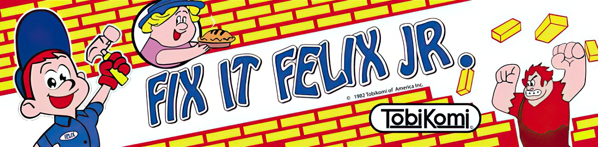

# Fix-It Felix Jr. on the "Tobikomi board"

A MiSTer FPGA arcade core for a 1982 arcade board that never existed, running a from-scratch rebuild of Fix-It Felix Jr.

Fix-It Felix Jr. is the arcade game inside the film Wreck-It Ralph (2012). In the film it is a 1982 cabinet made by the "Tobikomi Company". A playable version was later made for promotional cabinets, but no real 1982 hardware ever ran it. This project asks what that board would have looked like, builds it in FPGA, and ports the game to it.

**No game data is distributed here.** The ROM set is built on your own PC by the ROM maker, from your own copy of the Windows promotional version of the game.

## What's in the package

| File | What it is |
|---|---|
| `release/_Arcade/cores/fifelix.rbf` | The core: the Tobikomi board in FPGA, built on JTFRAME |
| `release/_Arcade/Fix-It Felix Jr..mra` | The MRA: ROM layout and DIP switches |
| `release/felix_rom_maker_windows/felixrommaker.exe` | The ROM maker for Windows |
| `core/` | Source of the core (Verilog, JTFRAME config) |
| `game/` | Source of the game (C for SDCC/Z80) and of the ROM maker |

## Making the ROM

1. Put `felixrommaker.exe` next to your copy of the Windows version (`FixitFelixJr.exe` with its `Data` folder), or point it at it: `felixrommaker.exe --exe <path to FixitFelixJr.exe>`.
2. Optional extras:
   - `--megadrive <file>`: the Mega Drive version's ROM, for the two voice clips ("I'm gonna wreck it!", "I can fix it!").
   - `--atgames <res_fif folder>`: the AtGames version's files, used only for its two extra sounds (high-score initials entry, 2-player handover).

   Without them those sounds are silent, as in the Windows original.
3. It writes `felixjr.zip`. The tool checks every input file and its own output, so a ROM that builds is a ROM that works.
4. Copy `felixjr.zip` to `games/mame/` on the MiSTer SD card, and the contents of `release/_Arcade/` into `_Arcade/`.

## The board

The Tobikomi board is designed as if it were built in 1982, with a few period-plausible luxuries so the game can run as the original does:

| Block | Spec |
|---|---|
| CPU | Z80 at 8 MHz, 128 KB program ROM (32 KB fixed + 16 KB bank window), 4 KB work RAM |
| Screen | 240 x 320 portrait (a 320 x 240 raster turned on its side), 59.6 Hz, 6.857 MHz dot clock |
| Background | 8x8 tiles, 16 colours each, two pages, vertical and horizontal scroll |
| Text layer | 8x8 tiles over everything, two pages: HUD, text, the boot garbage |
| Sprites | 128 sprites of 16, 32 or 64 pixels, line buffer, "behind background" bit, a commit register so the sprite list, scroll and page flip change together |
| Colour | Palette PROMs, 1024 entries |
| Sound | Seta X1-010 sample chip, 16 voices of 8-bit PCM (due to the windows version using only PCM for all its sounds) |
| Settings | 3 DIP banks, plus 1 KB of battery-backed RAM for operator settings, bookkeeping and high scores |

## Controls

4-way stick, JUMP and FIX per player. Player 2 uses the second joystick; in cocktail mode the screen flips on player 2's turn. Coin, start, service and TEST as on other JT cores. Service is also in the OSD menu, so no keyboard is needed.

## DIP switches

Every switch at its default plays exactly like the original game.

| Switch | Choices |
|---|---|
| Lives | 3 (original), 2, 4, 5 |
| Bonus life | every 5,000 (original), 10,000, 20,000, none |
| Difficulty | normal (original), easy, hard, hardest |
| Demo sounds | on, off |
| Cabinet | upright, cocktail |
| Coin A / Coin B | 1 coin 1 credit (original) up to 1 coin 6 credits; free play on coin A |
| Invulnerability | off, on |

## Service mode

Flip TEST (F2, or the OSD Service Mode option) during the attract mode, or hold it at power-on. The test mode follows early-80s boards:

- RAM and ROM test, per EPROM
- input test, coin counter test, sound test
- screen test: crosshatch, colour bars, full-colour screens
- DIP switch readout
- extra settings (beyond the DIP switches): hammer hits (1, 2, 3 or by damage), starting level, level speed-up, Super Felix length, birds and obstacles, kill screen, continue, attract intro (full, short or 1 in 5 full), voices, save high scores
- bookkeeping and high-score reset

Extra settings, bookkeeping and high scores are saved to the SD card when you choose "Save settings" in the MiSTer OSD menu. At their defaults the game plays like the original; the attract demo always plays with the original settings.

## How it was made

- The Windows promotional build was decompiled and its game logic documented rule by rule: states, timers, tables, every draw call and sound trigger.
- The game was rewritten in C for the Z80, following that logic, and checked against the decompile with a full audit.
- The graphics were converted from the original sprite sheet into tile and sprite ROMs, and the sounds into the X1-010's sample ROM.
- The board was designed around what the game needs, then built in Verilog on JTFRAME, reusing JTFRAME's tilemap, scroll, object-drawing and memory modules and JT's X1-010.
- Everything was tested in a C++ model of the board, then on real MiSTer hardware on a CRT and via HDMI.

Where the period board can't do exactly what the Windows version does, it follows a real 1982 board: E.G. text and speech bubbles sit on the 8x8 grid.

## Building from source

- **Core:** the core uses JTFRAME, the T80 Z80 and the jtx1010 X1-010 from [jtcores](https://github.com/jotego/jtcores), unmodified, so they are not copied here. Check out jtcores (tested at commit `cab65970f`, 2026-10-20), copy `core/cores/felix` into its `cores/felix`, and build it as any JTFRAME core, for example `jtcore felix -mister --nodbg`.
- **MRA:** the finished MRA is in `release/_Arcade/`. To make it yourself, add the `felixjr` machine from `core/doc/felixjr.xml` to `doc/custom.xml` in your jtcores checkout (Felix has no MAME driver, so JTFRAME takes the ROM layout and DIP switches from there), source `setprj.sh`, then run `core/mkmra.sh`. It runs `jtframe mra felix --nodbg` and makes a few small fixes to the result: it sets the about line to this project (no twitter, source here), removes the unused "-" entries JTFRAME pads the coin switches with, points the MRA at fifelix.rbf (JTFRAME names it jtfelix after the folder), sets the rotation text to "vertical (ccw)", which is how the core sends the picture, and drops the md5 line of a ROM set that never existed. The output is identical to the released MRA.
- **Game and ROM maker:** see `game/README.md`. The game builds with SDCC, and the ROM maker with a C compiler (mingw-w64 for the Windows exe) or runs as the Python script.

## Licence

The core, the game and the ROM maker are free software under the GNU General Public License v3.0 or later (`LICENSE`). Copyright 2026 Chris Watson. The ROM maker includes stb_image and miniz under their own licences.

## Credits

- Core, game port and board design: Chris Watson
- JTFRAME and the X1-010 module: Jose Tejada (jotego)
- Z80: T80
- ROM maker libraries: stb_image (Sean Barrett), miniz (Rich Geldreich and contributors)
- Fix-It Felix Jr. and Wreck-It Ralph are owned by Disney. This is a non-commercial fan project with no connection to Disney or to the makers of the promotional game. No game data is included.
